<p align="center">
  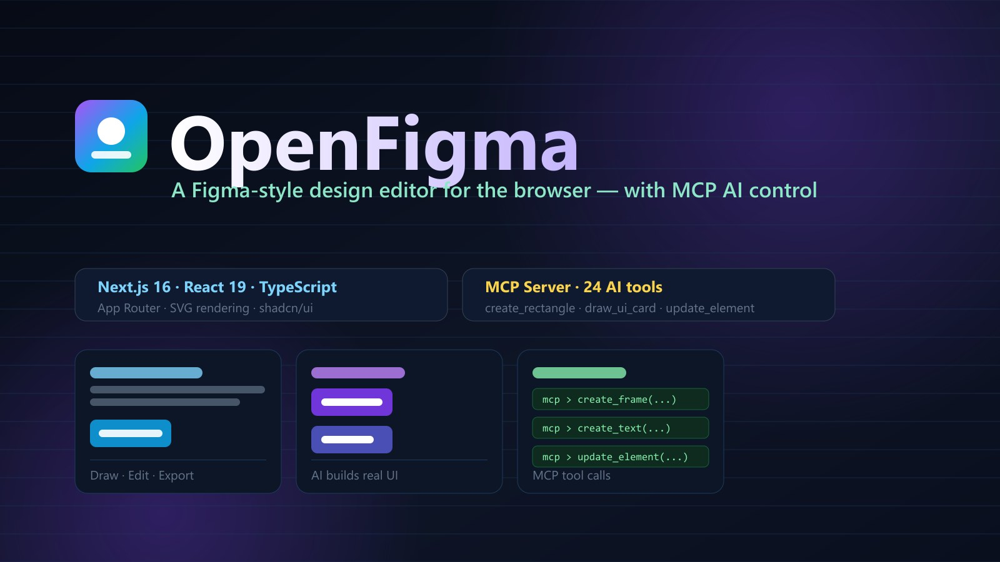
</p>

# 🎨 OpenFigma — محرر تصميم متجهي يعمل في المتصفح

**OpenFigma** هو استنساخ عملي لمحرر تصميم على طراز **Figma**، مبني بالكامل باستخدام **Next.js 16 + React 19 + TypeScript**، مع محرك رسم قائم على **SVG** وإدارة حالة عبر **Zustand**. المشروع جاهز للاستخدام الفوري: بدون قاعدة بيانات ثقيلة وبدون تعقيد نشر — شغّله وابدأ التصميم.

---

## ✨ ما الجديد في v0.4.0 — النقل الكامل (المراحل 0–16)

الموجة الأخيرة التي أغلقت النقل الكامل. فوق v0.2.0 (الرموز، البروتوتايب، التصدير، الاستيراد) وv0.3.0 (العمليات المنطقية/الأقنعة، الأنماط، شبكات التخطيط، القيود، النص، أدوات الدقة):

| المرحلة | ما أُنجز |
|---|---|
| 12 — Auto Layout كامل | wrap، تحجيم FIXED/HUG/FILL للإطار **والأبناء** معًا، min/max، محاذاة baseline، أبناء absolute، إعادة ترتيب عند الإفلات، لوحة بمطابقة Figma |
| 13 — عمق النص | محاذاة عمودية، justified بتوزيع الكلمات، قوائم مرتبة/غير مرتبة ببادئة معلّقة + whitelist موحّد لـ POST/PUT (إصلاح أمني) |
| 14 — تدرجات كاملة | angular (قطاعات conic فعلية) + diamond (خطي 45° بكل ربع حسب \|dx\|+\|dy\| بدقة) + إصلاح خلل كامن في فهرسة fill-pattern |
| 15 — عناصر جديدة | Section (حاوية كاملة)، Table (نموذج خلايا بتحرير بنقرة مزدوجة)، Sticky |
| 16 — تعاون ولمسات | نظام تعليقات (دبابيس، خيوط، resolve)، تنعيم زوايا (بيزييه تكعيبية 0.5523 → 1.29)، محفزات mouse-enter/leave/down/up منفصلة، اختصارات التكبير Shift+1/0/2 |

أُغلقت كل المراحل بـ `tsc --noEmit` + `eslint` + `next build` بصفر أخطاء، مع تحقق حي في المتصفح ولقطات مؤكدة عبر VLM.

---

## 📸 لقطات

لقطات منتقاة — مُتحقق منها حيًا في المتصفح ومؤكدة عبر VLM. الصور المهمة فقط في `img/`؛ المجموعة الكاملة مرحلةً بمرحلة (30 لقطة) في `download/`.

**السطح اليومي**

<p align="center">
  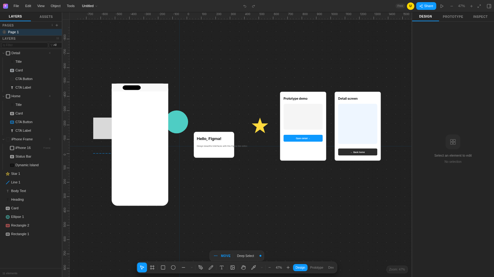
  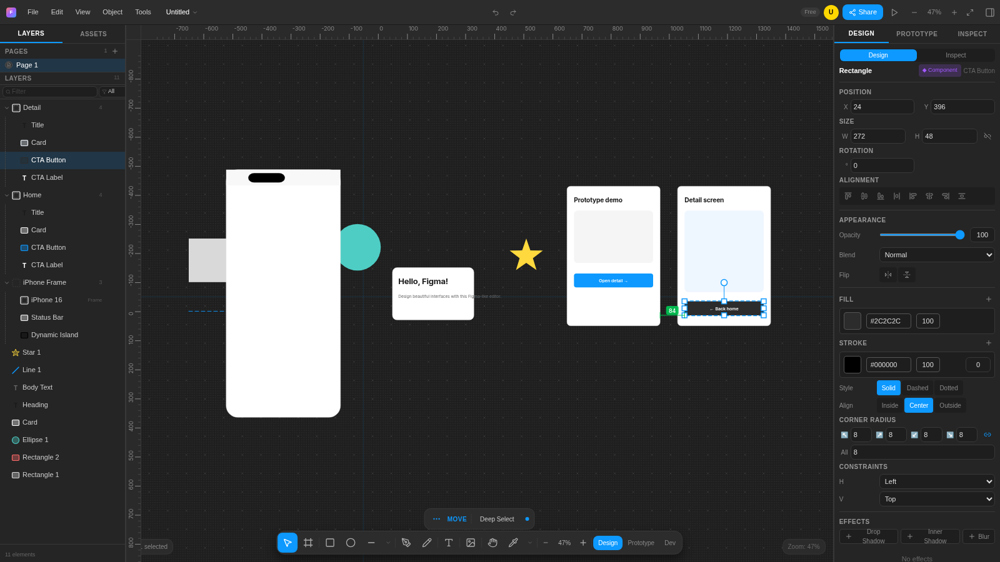
</p>

**الطلاء والهندسة**

<p align="center">
  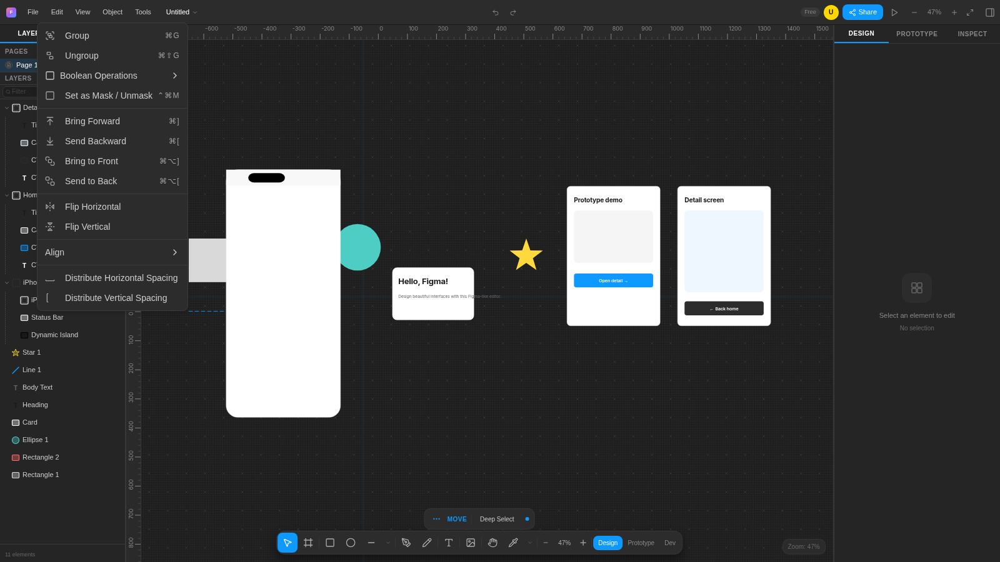
  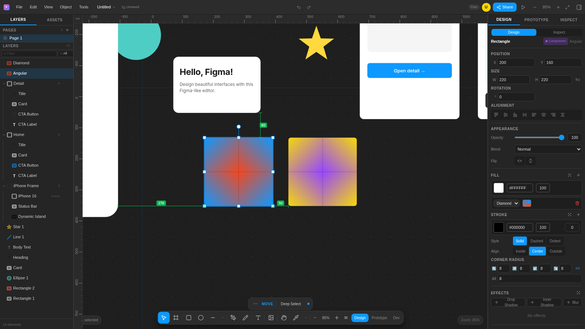
</p>

**أنظمة التصميم**

<p align="center">
  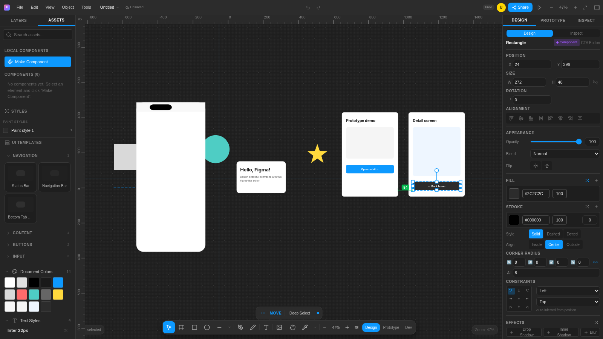
  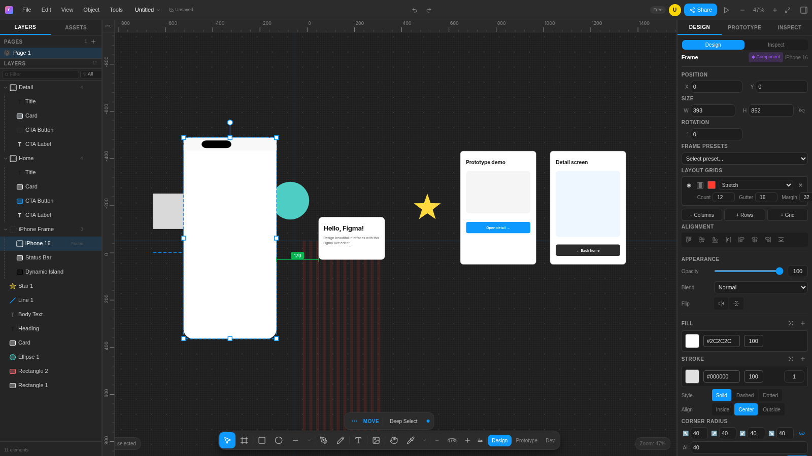
</p>

**محركات التخطيط**

<p align="center">
  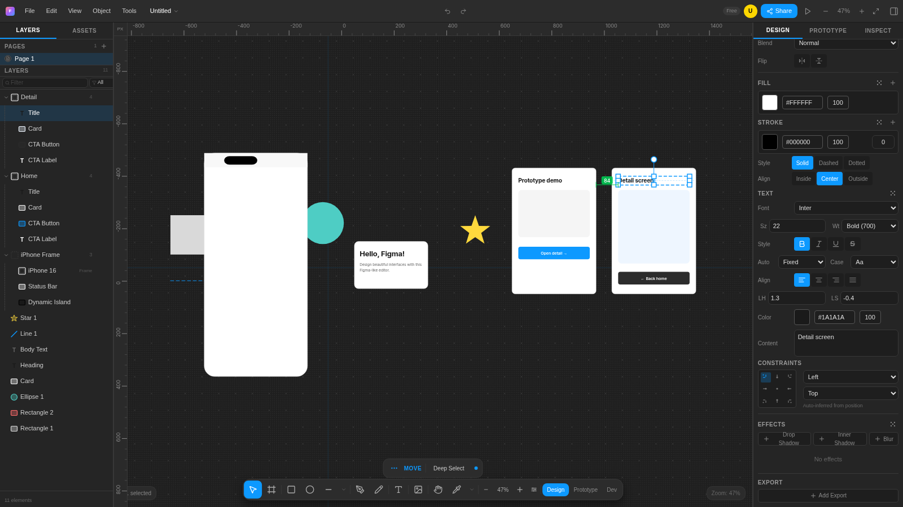
  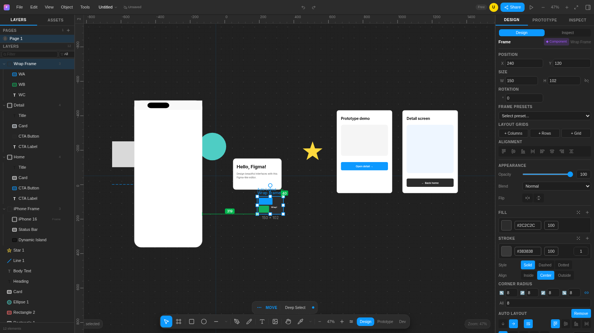
</p>

**المحتوى والتعاون**

<p align="center">
  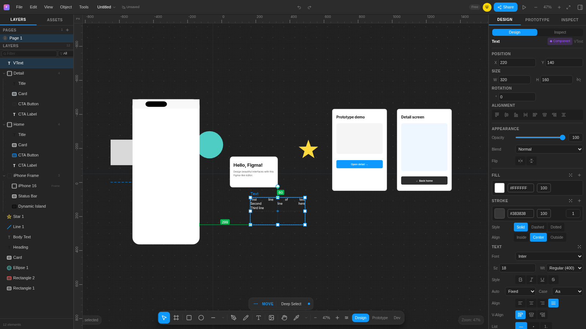
  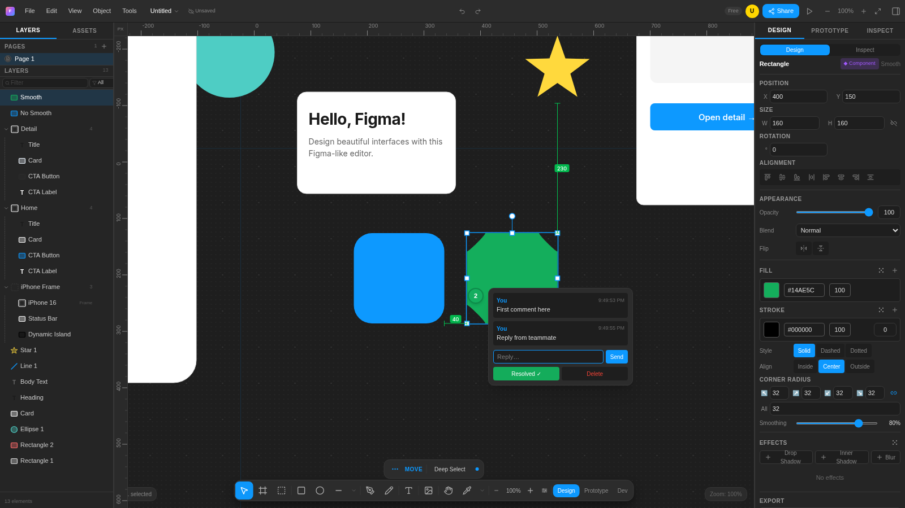
</p>

**البروتوتايب والعناصر الجديدة**

<p align="center">
  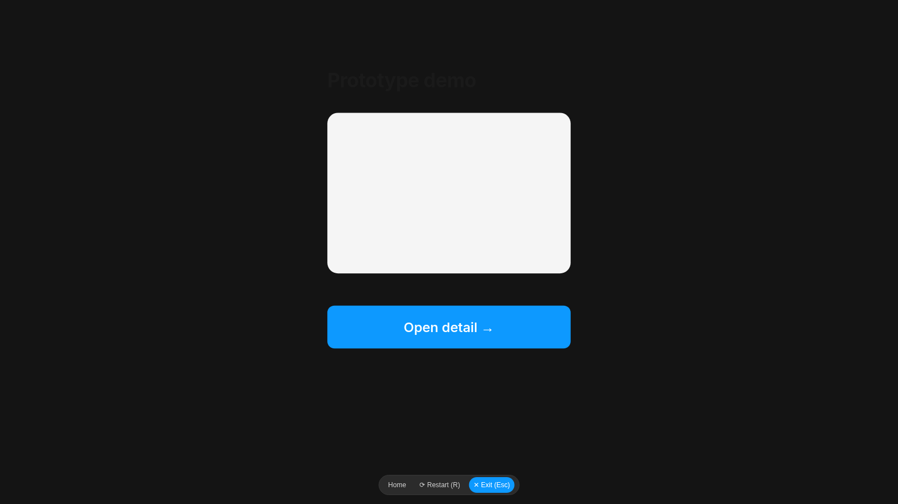
  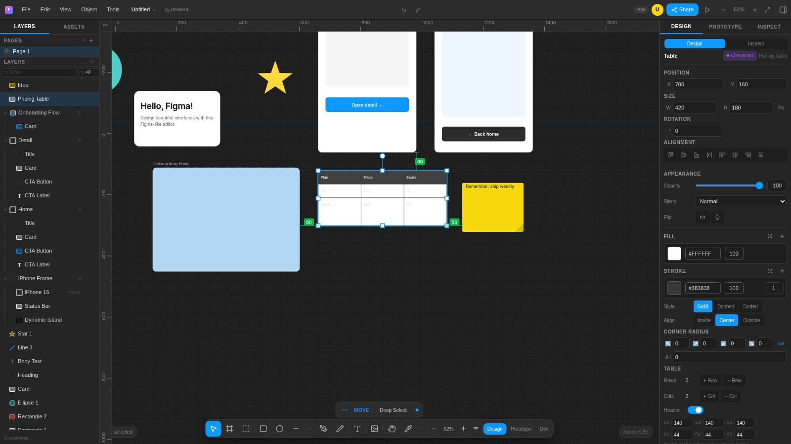
</p>

---

## 📖 كيف بدأ المشروع

بدأت الفكرة في ديسمبر 2025 كتجربة لفهم **كيف تعمل محررات التصميم الحقيقية من الداخل**:

1. **تشريح الأصل** — درسنا سلوك فايغما على اللوحة ميزةً ميزة: التحديد، الالتصاق، الأدلة الذكية، التخطيط، السجل الزمني.
2. **إعادة بناء نظيف بأدوات مفتوحة** — بدلاً من التقليد الأعمى، أُعيد بناء كل ميزة من الصفر: Next.js وReact بدل بنية واجهة فايغما الأصلية، وSVG بدل محرك C++/WebGL.
3. **سجل قرارات معمارية موثق** — كل قرار هام (SVG مقابل WebGL، Zustand مقابل Redux، حفظ مزدوج...) سُجل لحظة اتخاذه مع البدائل والتبريرات.
4. **تحقق منهجي** — تُختبر الميزات واحدة تلو الأخرى مقابل السلوك الأصلي: أكثر من 50 ميزة أساسية (أدلة ذكية، عمليات منطقية، Auto Layout، مكونات، Undo/Redo...) وصلت إلى ✅ **متحقق 100%**.

---

## 🧠 كيف يعمل المشروع (المعمارية)

```
┌────────────────────────────────────────────────────┐
│                     المتصفح                         │
│                                                    │
│  EditorLayout (الهيكل)                             │
│  ├── Toolbar         شريط الأدوات                   │
│  ├── Canvas.tsx      لوحة SVG (زوم/بان/أدوات/تحديد)  │
│  ├── LayerPanel      شجرة الطبقات                   │
│  └── PropertiesPanel لوحة الخصائص                   │
│            │                                       │
│            ▼                                       │
│  Zustand Store (editor-store.ts)                   │
│  العناصر · الصفحات · التحديد · السجل · الحافظة        │
│            │                                       │
│            ▼                                       │
│  منطق مجرد                                          │
│  element-utils · auto-layout · boolean-ops          │
│  snap-utils · export · image-utils                 │
│            │                                       │
│            ▼                                       │
│  الحفظ                                              │
│  IndexedDB (تلقائي كل 30ث) + JSON على السيرفر        │
└────────────────────────────────────────────────────┘
        ▲
        │ HTTP (25+ مسار API)
        │
   MCP Server ──── وكيل الذكاء الاصطناعي (Claude / opencode / Cursor)
```

### نموذج البيانات الأساسي
كل شيء على اللوحة هو `DesignElement` — شجرة عناصر مرتبطة بـ `parentId`:
- **الأنواع:** `rectangle, ellipse, text, line, polygon, star, arrow, frame, image, pen/mask, boolean`
- **الخصائص:** موضع وحجم وتدوير، طبقات تعبئة (تدرجات/صور)، حدود، ظلال وضباب، شفافية ووضع مزج
- الإطارات/المجموعات تضم أبناء، ومع **Auto Layout** يُعاد حساب التخطيط تلقائياً عند تغيّرهم

### تدفق تفاعل المستخدم
1. حدث المستخدم يلتقطه `Canvas.tsx` (ضغطة/سحب/كتابة)
2. أثناء الرسم: معاينة `<rect>` حية، وعند الإفلات يمر عبر `addElement`
3. إجراء على المخزن (70+ إجراء) يستدعي `pushHistory` (نقطة تراجع)
4. تحديث انتقائي عبر المحددات (selectors) — بدون إعادة رسم شامل

### الميزات الجاهزة فوراً
- **نظام التصميم (مطابقة UI3)** — مجموعة رموز `--fig-*` في `globals.css`: سلم طباعة (9–13px بأوزان 450/550)، استدارة 2/5/13px، فراغات 4–40px، ظلال 100–500، وأبعاد UI3 (أزرار أدوات 32×32، شريط أدوات 48px، لوحات 241/320px، صفوف طبقات 28px)
- **التحرير** — تحديد مفرد/متعدد + مربع السحب، مقابض تحجيم ثمانية، تدوير 15° مع Shift، تكرار Alt+Drag
- **الأدلة الذكية** — خطوط محاذاة حمراء منقطة، التصاق شبكي 6px، قياس المسافات بـ Alt+Hover
- **نص مضمّن** — نقرة مزدوجة للتحرير مباشرة في اللوحة
- **عمليات منطقية** — Union / Subtract / Intersect / Exclude على مسارات المتجهات
- **Auto Layout** — اتجاهات، فراغات، هامش داخلي، محاذاة وأنماط تحجيم
- **مكونات وVariants** — إنشاء/استنساخ/فصل، ولوحات ألوان وخطوط المستند
- **التصدير** — PNG / JPG / SVG / PDF / WEBP عبر `ExportPanel` (لكل عنصر، مقياس 1x/2x/4x، جودة قابلة للضبط لـJPG/WEBP) أو عبر API
- **نظام Prototype** — نموذج تفاعلات بخمسة محفزات (click/hover/drag/keypress/delay) × خمسة أفعال (navigate/open-overlay/close-overlay/url/back) × 8 حركات بينها **Smart Animate** (مطابقة بالمسار الاسمي بين الإطارات)، مشغّل ملء الشاشة (`▶` في الشريط العلوي، Esc للخروج، سجل رجوع)، وباني تفاعلات كامل في تبويب Prototype
- **الاستيراد** — صور (منتقي أو إفلات موحّد)، ملفات SVG تُحلّل بـDOMParser إلى شجرة `DesignElement` قابلة للتحرير (ليست صورة مسطحة)، وJSON مشروع (استبدال أو دمج)
- **نظام صفحات متعدد**، وتوليد كود CSS بتبويب Inspect
- **تراجع/إعادة** — سجل لقطات يُعبأ من 25+ موقع استدعاء

### طبقة الحفظ المزدوجة
| المسار | الملف | الاستخدام |
|---|---|---|
| المتصفح | `storage.ts` → IndexedDB | حفظ تلقائي كل 30 ثانية، يُحمل عند البدء |
| السيرفر | `server-state.ts` → `.design-data/<id>.json` | مصدر الحقيقة الواحد للـ API وخادم MCP |

نفس البيانات تمر عبر 8 مسارات Next.js App Router تحت `/api/editor/projects/...` (المشاريع، العناصر، الصفحات، الأدوات، أحداث SSE) — وهذا ما يجعل المحرر قابلاً للتحكم برمجياً وذكائياً.

---

## 🚀 التشغيل محلياً

```bash
npm install      # التبعيات
npm run dev      # سيرفر التطوير على http://localhost:3000
```

- لا تحتاج أي إعداد قاعدة بيانات — مشهد تجريبي (إطار iPhone 16 وتدفق Home→Detail يمكنك تشغيله بزر `▶`) يُحمّل عند أول زيارة؛ وتصميم "VidVerse" الكامل متاح عبر **File ← Load Demo Design**
- يتطلب Node 18+

---

## 🤖 ربط المحرر بـ MCP (بروتوكول سياق النموذج)

### ما يعنيه MCP هنا
خادم MCP جاهز للعمل يقع في `mcp-server/` ويتصل عبر **بروتوكول JSON-RPC على قناة stdio**.
الوكيل الذكي (AI agent) يستهلكه ويتحدث مع المحرر: يرسل أوامر fetch إلى API السيرفر الذي يخلق/يعدل/يقرأ تصميمك.

```
الوكيل الذكي (Claude Desktop / opencode / Cursor)
        │  استدعاء أداة  مثال: create_rectangle({x:100,...})
        ▼
MCP Server (mcp-server/dist/index.js عبر stdio)
        │  fetch http://localhost:3000/api/...
        ▼
API Routes (Next.js)  ──►  server-state.ts  ──►  .design-data/<id>.json
        │
        ▼
التصميم يحدث ويحفظ — والتطبيق يعرضه حياً
```

> ⚠️ يجب أن يكون سيرفر المحرر يعمل (`npm run dev`) على المنفذ 3000 — MCP يتحدث معه عبر HTTP.

### خطوة 1 — بناء خادم MCP
```bash
cd mcp-server
npm install
npm run build     # ينتج mcp-server/dist/index.js
```
> خادم MCP **غير** مبني مسبقاً في هذا المستودع — تبعياته تُثبّت منفصلة عن التطبيق الرئيسي، فنفّذ الأوامر الثلاثة أعلاه مرة واحدة قبل أول استخدام.

### خطوة 2 — تكوين الاتصال
ملف `mcp-config.json` في جذر المشروع (يأتي بمسار نسبي محمول — شغّل عميل MCP من جذر المستودع):
```json
{
  "mcpServers": {
    "figma-editor": {
      "command": "node",
      "args": ["mcp-server/dist/index.js"],
      "env": { "EDITOR_API_URL": "http://localhost:3000" }
    }
  }
}
```
استخدم مساراً مطلقاً لـ`dist/index.js` إن كان عميل MCP لا يحلّ المسارات النسبية، وعدّل `EDITOR_API_URL` إن كان السيرفر على منفذ آخر.

### خطوة 3 — التسجيل حسب العميل

| العميل | الملف | المكان |
|---|---|---|
| **Claude Desktop** | `claude_desktop_config.json` | `%APPDATA%\Claude\` — أضف قسم `mcpServers` أعلاه |
| **opencode** | `opencode.json` | جذر المشروع: `"mcp": { "figma-editor": { "type": "local", "command": ["node", "...\\dist\\index.js"], "environment": { "EDITOR_API_URL": "http://localhost:3000" } } }` |
| **Cursor** | `mcp.json` | `.cursor/mcp.json` في المشروع أو `~/.cursor/` |
| **VS Code (Copilot)** | `mcp.json` | `.vscode/mcp.json` بنفس البنية |

بعد حفظ ملف التكوين **أعد فتح العميل** ليكتشف الأدوات.

### خطوة 4 — أول مهمة للذكاء الاصطناعي
اكتب مثل:
```
أنشئ مشروعاً "Login UI" وفيه إطار رمادي اللون
وداخله بطاقة بيضاء فيها زر أخضر "تسجيل الدخول"
```
الوكيل سينفذ التسلسل تلقائياً:
`list_projects → create_project → create_frame → create_text → update_element ...`

### جميع أدوات MCP المتاحة (52)

> العدّ متحقق من الكود المصدري: 16 تسجيلاً مباشراً + 36 أداة يولّدها `makeCreateTool` / `toolAction` = **52 أداة**.

| الفئة | الأدوات |
|---|---|
| 📂 المشاريع (4) | `create_project` · `list_projects` · `get_project` · `delete_project` |
| ✏️ إنشاء عناصر (8) | `create_rectangle` · `create_ellipse` · `create_frame` · `create_line` · `create_polygon` · `create_star` · `create_arrow` · `create_text` |
| 🔧 CRUD العناصر (4) | `get_element` · `update_element` · `delete_element` · `list_elements` |
| 🔄 تحريك وترتيب (11) | `move_element` · `move_element_to` · `resize_element` · `rotate_element` · `duplicate_element` · `group_elements` · `ungroup_elements` · `bring_forward` · `send_backward` · `bring_to_front` · `send_to_back` |
| 📐 محاذاة وتوزيع (2) | `align_elements` · `distribute_elements` |
| 🎨 تنسيق (8) | `set_fill` · `set_stroke` · `set_corner_radius` · `set_opacity` · `set_blend_mode` · `add_shadow` · `flip_horizontal` · `flip_vertical` |
| ✍️ نص (2) | `set_text_content` · `set_text_style` |
| 🔒 إظهار وبيانات (3) | `set_visible` · `set_locked` · `rename_element` |
| 🔍 استعلام (2) | `search_elements` · `get_all_elements` |
| 🧹 اللوحة (1) | `clear_canvas` |
| 📄 الصفحات (4) | `list_pages` · `create_page` · `set_active_page` · `delete_page` |
| 🧩 واجهات جاهزة (3) | `draw_ui_card` · `draw_button` · `draw_phone_frame` |

### استكشاف أخطاء MCP

| المشكلة | الحل |
|---|---|
| الأدوات لا تظهر في العميل | جرّب `node mcp-server\dist\index.js` يدوياً — إن استمر معلقاً فالسيرفر سليم؛ صحح تكوين العميل وأعد تشغيله |
| `fetch failed` في نتائج الأداة | سيرفر المحرر غير يعمل — شغّل `npm run dev` أولاً |
| `EADDRINUSE :3000` | يوجد سيرفر قديم يعمل: أوقفه أو استخدم منفذاً آخر (`next dev -p 3001`) |
| `project not found` | نفّذ `list_projects` وانسخ المعرف الصحيح |
| مسار `dist` تغيّر بعد التعديل | عدّل المسار في `mcp-config.json`/تكوين العميل |

---

## 🗂️ بنية المشروع

```
├── src/app/           صفحة المحرر + 8 مسارات API (بينها SSE‏ /events)
├── src/components/
│   ├── editor/        مكوّنات المحرر + canvas/ hooks (Canvas، Toolbar، اللوحات،
│   │                  مشغّل prototype/ وباني التفاعلات، ExportPanel...)
│   └── ui/            5 مكوّنات shadcn/ui (المستخدمة فعلاً)
├── src/lib/           منطق المحرك (element-utils, auto-layout, boolean-ops, snap-utils, storage,
│   │                  server-state, server-project, export, import/{image,svg,project},
│   │                  prototype/{transitions,smart-animate}, events/bus)
├── src/types/         prototype.ts (نموذج Interaction)
├── src/store/         editor-store.ts (Zustand، ~2600 سطر)
├── src/data/          demo-design.ts (عرض VidVerse — من قائمة File)
├── mcp-server/        خادم MCP (52 أداة) + config
├── prisma/            schema (اختياري)
└── img/               sign.jpeg (الغلاف) + 12 لقطة منتقاة
```

---

<p align="center">
  <sub>Built with Next.js 16 · React 19 · SVG · Zustand · shadcn/ui · MCP</sub>
</p>
