<p align="center">
  
</p>

# 🎨 OpenFigma — A Figma-Style Design Editor for the Browser

**OpenFigma** is a practical, production-shaped clone of a **Figma-like** vector design editor, built entirely with **Next.js 16 + React 19 + TypeScript**, an **SVG rendering engine**, and **Zustand** state management. Fully useable out of the box: no heavy database, no deploy complexity — run it and start designing.

---

## ✨ What's new in v0.5.0 — terminal audit wave (phases 17–23)

Final wave from the terminal audit — three fresh search surfaces over the source corpus (every remaining gap closed, every rejection documented with evidence). On top of v0.4.0 (auto layout, text depth, full gradients, Section/Table/Sticky, comments):

| Phase | Delivered |
|---|---|
| 17 — Paint & vector | pattern paint (tiled fills), outline stroke, flatten, arc tool (donut geometry) |
| 18 — Vector editing | vector edit on parametric shapes (exact Bézier conversion), split vector network |
| 19 — Text advances | text on path (any target + offset slider), hyperlink runs (rendered, clickable in the player), emoji picker, place-image queue mode |
| 20 — Prototype advances | flow starting points (named, first-start precedence), fixed-when-scrolling overlay, Change To, Scroll To |
| 21 — Edit & view parity | paste-over, select-similar/inverse (8 criteria), find & replace (all pages), outlines mode (+hidden/bounds), pixel preview (+retina) |
| 22 — Collaboration | multiplayer presence (SSE cursors/viewport/selection), version history (named + autosave, restore-as-new-version), published libraries (subscribe + master/instance insert) |
| 23 — Audit wave | copy as PNG/SVG/text/layer-name, copy/paste properties, paste here, unlock all, resize-to-fit, math in inputs, frame selection, nudge amounts, shortcuts modal (⌘/), show-comments toggle, add variant |

All phases closed with `tsc --noEmit` + `eslint` + `next build` at zero errors, live browser verification and VLM-checked screenshots.

---

## 📸 Screenshots

Curated captures — live-verified in the browser and VLM-checked. Only the significant ones live in `img/`; the full phase-by-phase set (28 shots) is in `download/`.

**The everyday surface**

<p align="center">
  
  
</p>

**Paint & geometry**

<p align="center">
  
  
</p>

**Design systems**

<p align="center">
  
  
</p>

**Layout engines**

<p align="center">
  
  
</p>

**Content & collaboration**

<p align="center">
  
  
</p>

**Prototype & new elements**

<p align="center">
  
  
</p>

**Wave 2 — paint & vector tools**

<p align="center">
  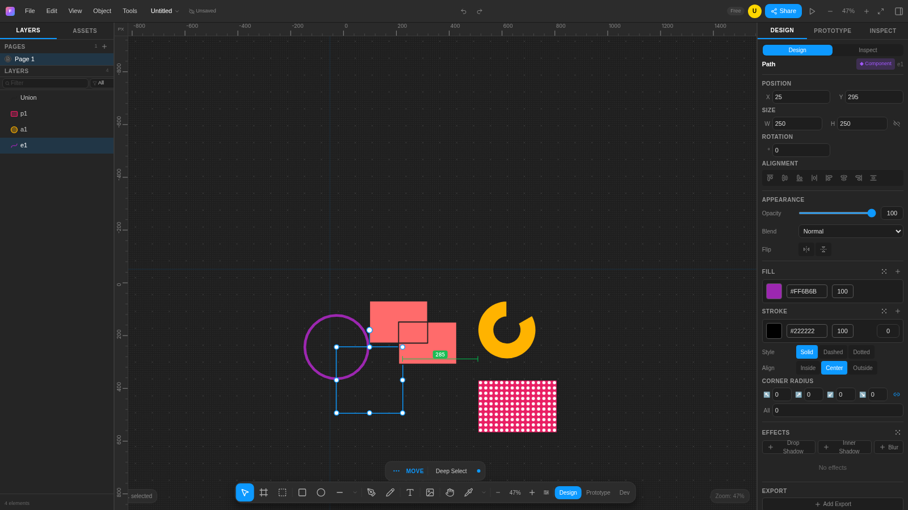
  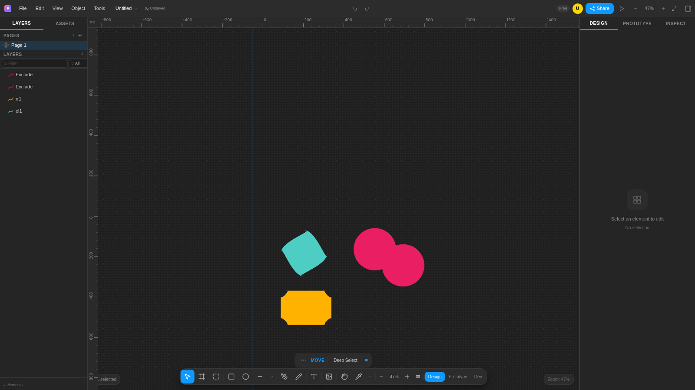
</p>

**Text on path & prototype depth**

<p align="center">
  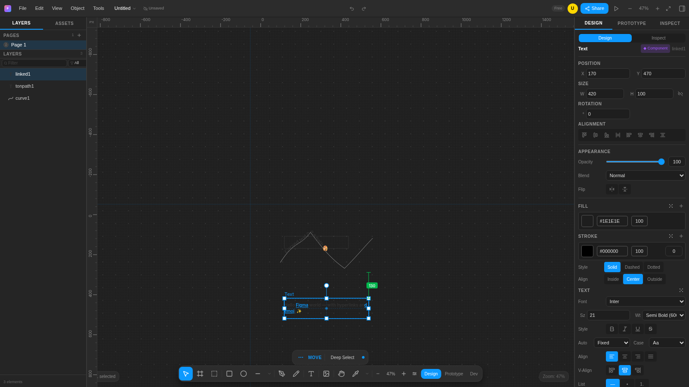
  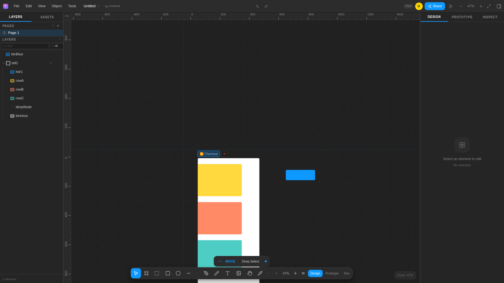
</p>

**Power editing & view modes**

<p align="center">
  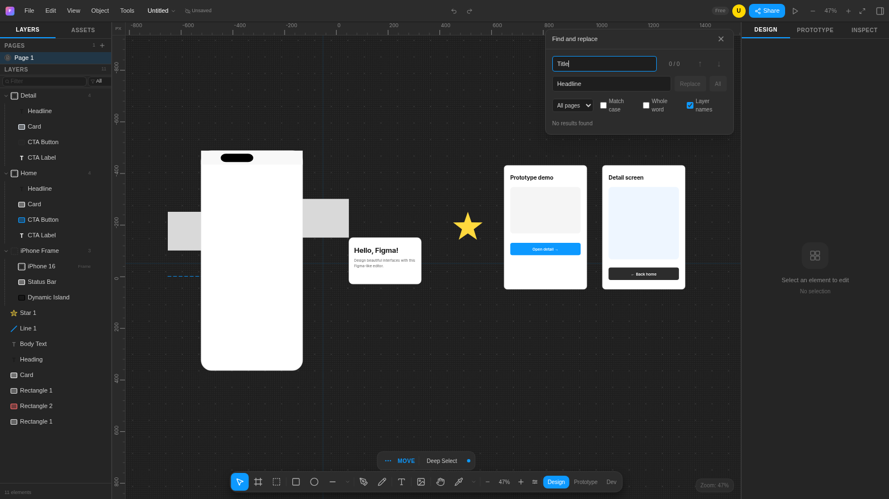
  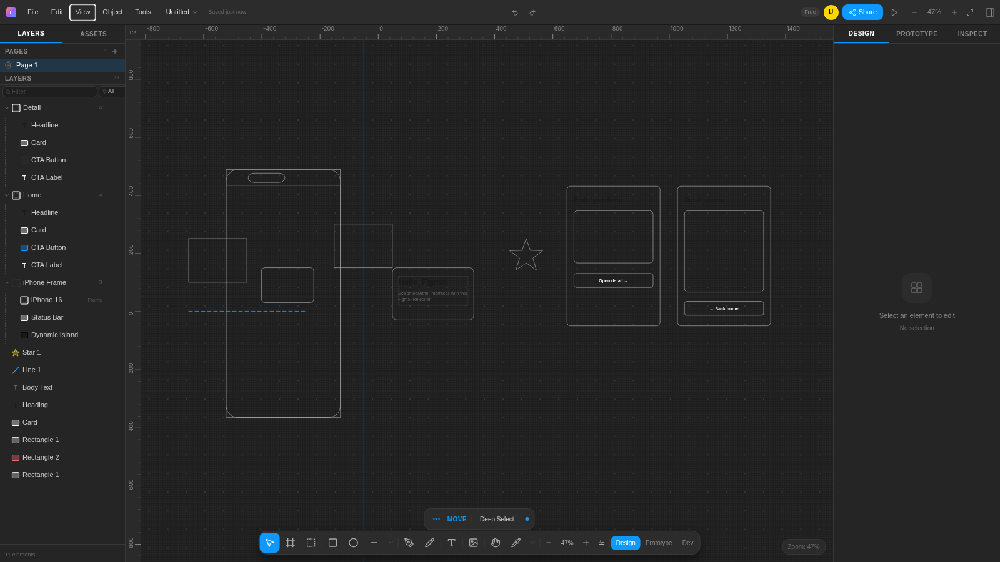
</p>

**View parity & multiplayer**

<p align="center">
  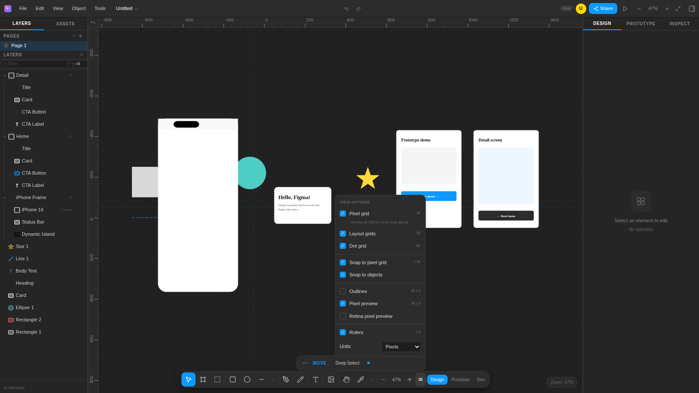
  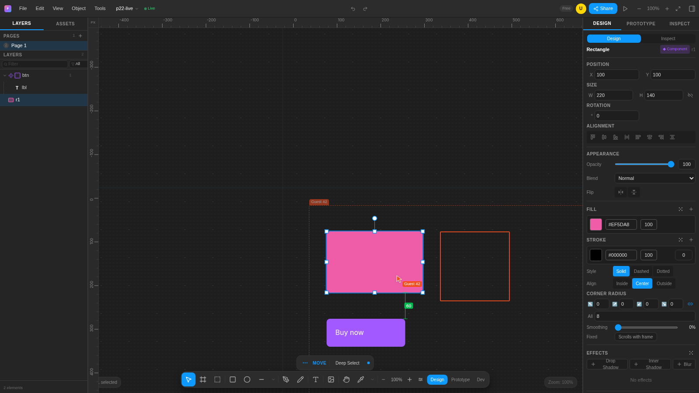
</p>

**Version history & libraries**

<p align="center">
  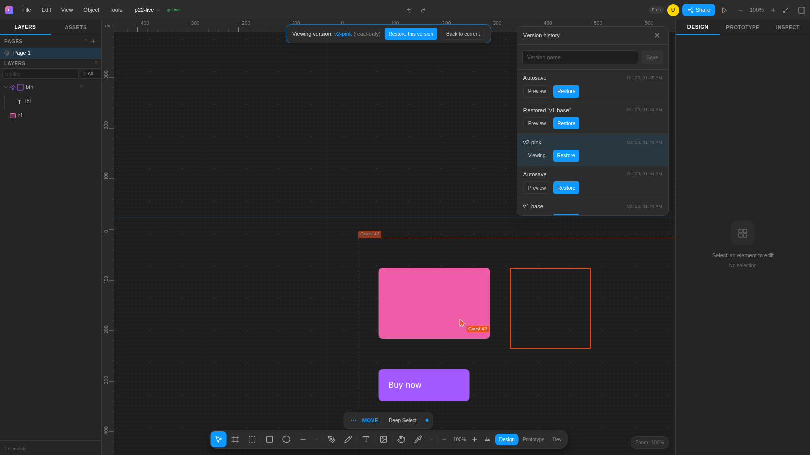
  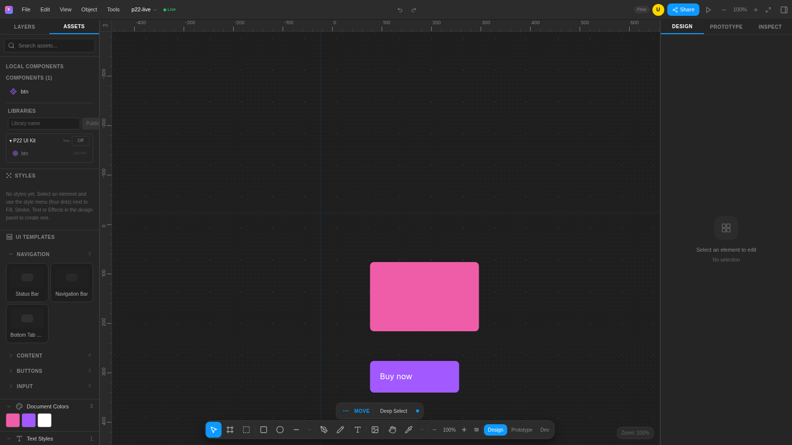
</p>

**Polish wave (shortcuts & variants)**

<p align="center">
  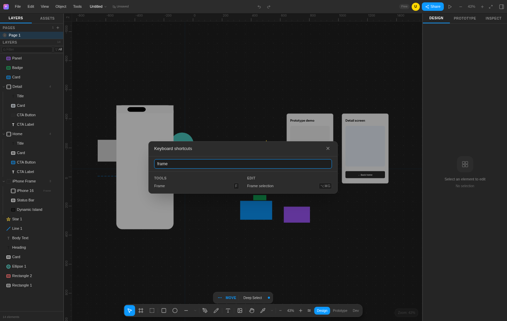
  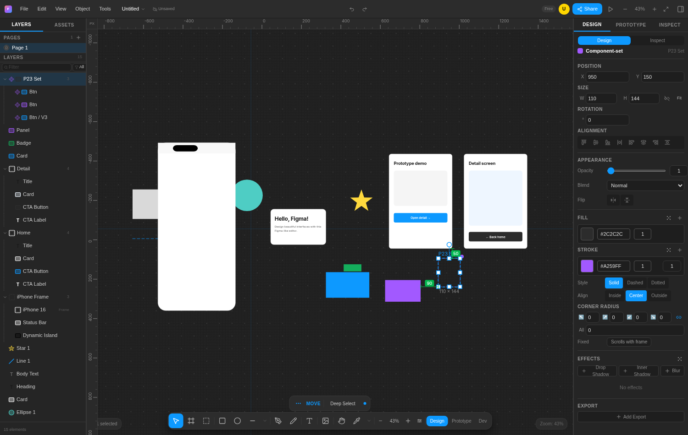
</p>

---

## 📖 How it started

The idea began in December 2025 as an experiment to understand **how real design editors work from the inside**:

1. **Deconstructing the original** — the way Figma behaves on the canvas was studied feature by feature: selection, snapping, guides, layout, history.
2. **Clean rebuild with open tools** — instead of copying, every feature was rebuilt from scratch: Next.js + React instead of the original web stack, SVG instead of the C++/WebGL engine.
3. **Documented architectural decisions** — every important trade-off (SVG vs WebGL, Zustand vs Redux, dual persistence...) was written down with alternatives and reasoning as it was made.
4. **Methodical verification** — features are checked one by one against the original behavior: more than 50 core features (smart guides, boolean ops, auto-layout, components, undo/redo...) reached ✅ **100% verified**.

---

## 🧠 How it works (Architecture)

```
┌────────────────────────────────────────────────────┐
│                     Browser                        │
│                                                    │
│  EditorLayout (shell)                              │
│  ├── Toolbar          tool strip                   │
│  ├── Canvas.tsx       SVG canvas (zoom/pan/tools)  │
│  ├── LayerPanel       layer tree                   │
│  └── PropertiesPanel  property inspector           │
│            │                                       │
│            ▼                                       │
│  Zustand Store (editor-store.ts)                   │
│  elements · pages · selection · history · clipboard│
│            │                                       │
│            ▼                                       │
│  Pure logic                                        │
│  element-utils · auto-layout · boolean-ops          │
│  snap-utils · export · image-utils                 │
│            │                                       │
│            ▼                                       │
│  Persistence                                       │
│  IndexedDB (auto-save 30s) + JSON on server        │
└────────────────────────────────────────────────────┘
        ▲
        │  HTTP (8 API routes)
        │
   MCP Server ──── AI agent (Claude / opencode / Cursor)
```

### Core data model
Everything on the canvas is a `DesignElement` — a tree linked by `parentId`:
- **Types:** `rectangle, ellipse, text, line, polygon, star, arrow, frame, image, pen/mask, boolean`
- **Properties:** position/size/rotation, fill layers (solid/gradient/image), strokes, shadows & blur, opacity, blend mode
- Frames/groups hold children; with **Auto Layout** the layout recalculates automatically when children change

### User interaction flow
1. A user event is captured by `Canvas.tsx` (click / drag / type)
2. While drawing: a live `<rect>` preview; on release it goes through `addElement`
3. A store action runs (70+ actions) and calls `pushHistory` (undo point)
4. Selective re-render via selectors — no full tree re-paint

### Ready-to-use feature set
- **Design system (UI3 parity)** — Figma `--fig-*` token set in `globals.css`: typography scale (9–13px, 450/550 weights), radius 2/5/13px, spacers 4–40px, elevation 100–500, and UI3 dimensions (32×32 tool buttons, 48px toolbar pill, 241/320px panels, 28px layer rows)
- **Editing** — single/multi select + rubber band, 8 resize handles, 15° rotation (Shift), Alt+Drag duplicate
- **Smart guides** — red dashed alignment lines, 6px grid snap, Alt+Hover distance measurement
- **Inline text** — double-click to edit text directly on the canvas
- **Boolean ops** — Union / Subtract / Intersect / Exclude on vector paths
- **Auto Layout** — direction, gap, padding, alignment, sizing modes
- **Components & variants** — create/instance/detach, document colors and fonts panels
- **Export** — PNG / JPG / SVG / PDF / WEBP via `ExportPanel` (per-element, scale 1x/2x/4x, adjustable quality for JPG/WEBP) or the API
- **Prototype system** — interaction model with 9 triggers (click/hover/drag/keypress/delay + separate mouse enter/leave/down/up) × 7 actions (navigate/open-overlay/close-overlay/url/back/change-to/scroll-to) × 8 animations incl. **Smart Animate** (name-path matching between frames), flow starting points, fixed-when-scrolling overlays, a fullscreen player (`▶` in the TopBar, Esc to exit, back stack) and a full interactions builder in the Prototype tab
- **Text on path & hyperlinks** — attach text to any path/ellipse/line target with an offset slider; hyperlink runs render underlined and open in the prototype player
- **Find & replace** — across all pages, with match-case / whole-word / layer-name options and a results list that jumps to each hit
- **Collaboration** — multiplayer presence (SSE cursors/viewport/selection), version history (named + autosave snapshots, restore-as-new-version), published libraries (subscribe + master/instance insert)
- **Import** — images (picker or unified drag & drop), SVG files parsed with DOMParser into an editable `DesignElement` tree (not a flat image), and project JSON (replace or merge)
- **Multi-page system**, CSS code generation in the Inspect tab
- **Undo/Redo** — snapshot history pushed from 25+ call sites

### Dual persistence layer
| Path | File | Usage |
|---|---|---|
| Browser | `storage.ts` → IndexedDB | auto-save every 30s, loaded on start |
| Server | `server-state.ts` → `.design-data/<id>.json` | single source of truth for API + MCP |

The same data flows through 8 Next.js App Router API routes under `/api/editor/projects/...` (projects, elements, pages, tools, SSE events) — this is what makes the editor scriptable and AI-controllable.

---

## 🚀 Run locally

```bash
npm install      # dependencies
npm run dev      # dev server on http://localhost:3000
```

- No database setup needed — a prototype-demo scene (iPhone 16 frame + a Home→Detail flow you can play with `▶`) loads on the first visit; the fuller "VidVerse" app design is available via **File → Load Demo Design**
- Requires Node 18+

---

## 🤖 Connecting the editor to MCP (Model Context Protocol)

### What MCP means here
The ready-to-run MCP server lives in `mcp-server/` and communicates over the **stdio JSON-RPC transport**.
The AI agent consumes it and talks to the editor: it sends `fetch` calls to the server API, which creates / edits / reads your designs.

```
AI agent (Claude Desktop / opencode / Cursor)
        │  tool call  e.g. create_rectangle({x:100,...})
        ▼
MCP Server (mcp-server/dist/index.js via stdio)
        │  fetch http://localhost:3000/api/...
        ▼
API Routes (Next.js)  ──►  server-state.ts  ──►  .design-data/<id>.json
        │
        ▼
Design updated & saved — the app shows it live
```

**Live sync is real:** mutation routes publish change events to an in-memory
bus (`src/lib/events/bus.ts`) and every open editor tab subscribes to its
project via SSE at `GET /api/editor/projects/:id/events?clientId=<tab-id>`.
Remote changes (MCP/AI, other tabs) are merged into the canvas instantly —
each event carries an `origin`, so a tab never receives echoes of its own
writes. The TopBar shows a ● Live / Sync… / Offline indicator while a server
project is open.

> ⚠️ The editor server must be running (`npm run dev`) on port 3000 — MCP talks to it over HTTP.

### Step 1 — Build the MCP server
```bash
cd mcp-server
npm install
npm run build     # produces mcp-server/dist/index.js
```
> The MCP server is **not** pre-built in this repo — its dependencies are installed separately from the main app, so run the three commands above once before first use.

### Step 2 — Configure the connection
`mcp-config.json` at the project root (ships with a portable relative path — run the MCP client from the repo root):
```json
{
  "mcpServers": {
    "figma-editor": {
      "command": "node",
      "args": ["mcp-server/dist/index.js"],
      "env": { "EDITOR_API_URL": "http://localhost:3000" }
    }
  }
}
```
Use an absolute `dist/index.js` path if your MCP client does not resolve relative paths, and adjust `EDITOR_API_URL` if the editor server runs on another port.

### Step 3 — Register with your client

| Client | File | Location |
|---|---|---|
| **Claude Desktop** | `claude_desktop_config.json` | `%APPDATA%\Claude\` — add the `mcpServers` block above |
| **opencode** | `opencode.json` | project root: `"mcp": { "figma-editor": { "type": "local", "command": ["node", "...\\dist\\index.js"], "environment": { "EDITOR_API_URL": "http://localhost:3000" } } }` |
| **Cursor** | `mcp.json` | `.cursor/mcp.json` in the project or `~/.cursor/` |
| **VS Code (Copilot)** | `mcp.json` | `.vscode/mcp.json` using the same structure |

Save the config file, then **restart the client** so it discovers the tools.

### Step 4 — Give the AI its first task
Type something like:
```
Create a project "Login UI" with a gray frame,
and inside it a white card with a green "Sign in" button
```
The agent will chain the tools automatically:
`list_projects → create_project → create_frame → create_text → update_element ...`

### All available MCP tools (52)

> Count verified from source: 16 direct registrations + 36 generated via `makeCreateTool` / `toolAction` helpers = **52 tools**.

| Category | Tools |
|---|---|
| 📂 Projects (4) | `create_project` · `list_projects` · `get_project` · `delete_project` |
| ✏️ Create elements (8) | `create_rectangle` · `create_ellipse` · `create_frame` · `create_line` · `create_polygon` · `create_star` · `create_arrow` · `create_text` |
| 🔧 Element CRUD (4) | `get_element` · `update_element` · `delete_element` · `list_elements` |
| 🔄 Transform & arrange (11) | `move_element` · `move_element_to` · `resize_element` · `rotate_element` · `duplicate_element` · `group_elements` · `ungroup_elements` · `bring_forward` · `send_backward` · `bring_to_front` · `send_to_back` |
| 📐 Align & distribute (2) | `align_elements` · `distribute_elements` |
| 🎨 Style (8) | `set_fill` · `set_stroke` · `set_corner_radius` · `set_opacity` · `set_blend_mode` · `add_shadow` · `flip_horizontal` · `flip_vertical` |
| ✍️ Text (2) | `set_text_content` · `set_text_style` |
| 🔒 Visibility & metadata (3) | `set_visible` · `set_locked` · `rename_element` |
| 🔍 Query (2) | `search_elements` · `get_all_elements` |
| 🧹 Canvas (1) | `clear_canvas` |
| 📄 Pages (4) | `list_pages` · `create_page` · `set_active_page` · `delete_page` |
| 🧩 Ready-made UI (3) | `draw_ui_card` · `draw_button` · `draw_phone_frame` |

### MCP troubleshooting

| Problem | Fix |
|---|---|
| Tools don't show in the client | Try `node mcp-server\dist\index.js` manually — if it stays alive the server is fine; fix the client config and restart it |
| `fetch failed` in tool results | The editor server isn't running — start `npm run dev` first |
| `EADDRINUSE :3000` | An old server is running: stop it or use another port (`next dev -p 3001`) |
| `project not found` | Run `list_projects` and copy the correct id |
| `dist` path changed | Update the path in `mcp-config.json` / client config |

---

## 🗂️ Project structure

```
├── src/app/           editor page + 8 API routes (incl. SSE /events)
├── src/components/
│   ├── editor/        editor components + canvas/ hooks (Canvas, Toolbar, Panels,
│   │                  prototype/ player + interactions, ExportPanel...)
│   └── ui/            5 shadcn/ui components (in use)
├── src/lib/           engine logic (element-utils, auto-layout, boolean-ops, snap-utils, storage,
│   │                  server-state, server-project, export, import/{image,svg,project},
│   │                  prototype/{transitions,smart-animate}, events/bus)
├── src/types/         prototype.ts (Interaction model)
├── src/store/         editor-store.ts (Zustand, ~2600 lines)
├── src/data/          demo-design.ts (VidVerse demo — via File menu)
├── mcp-server/        MCP server (52 tools) + config
├── prisma/            schema (optional)
└── img/               sign.jpeg (cover) + 24 curated screenshots
```

---

<p align="center">
  <sub>Built with Next.js 16 · React 19 · SVG · Zustand · shadcn/ui · MCP</sub>
</p>
